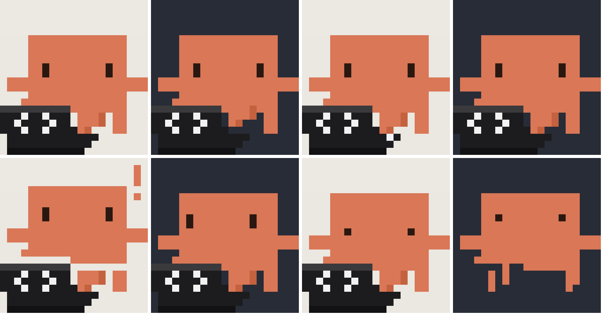
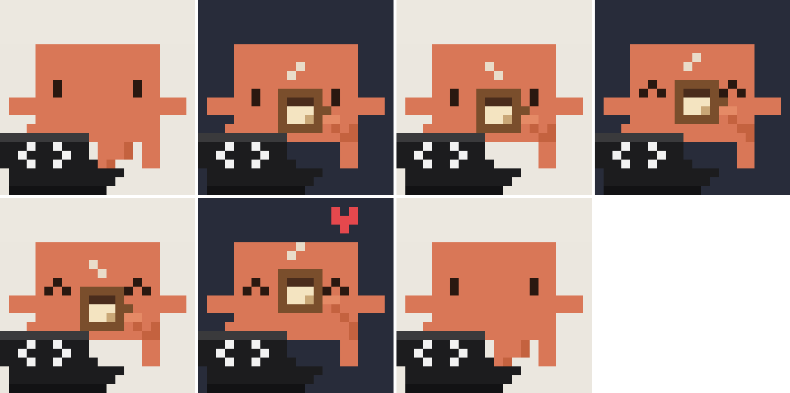
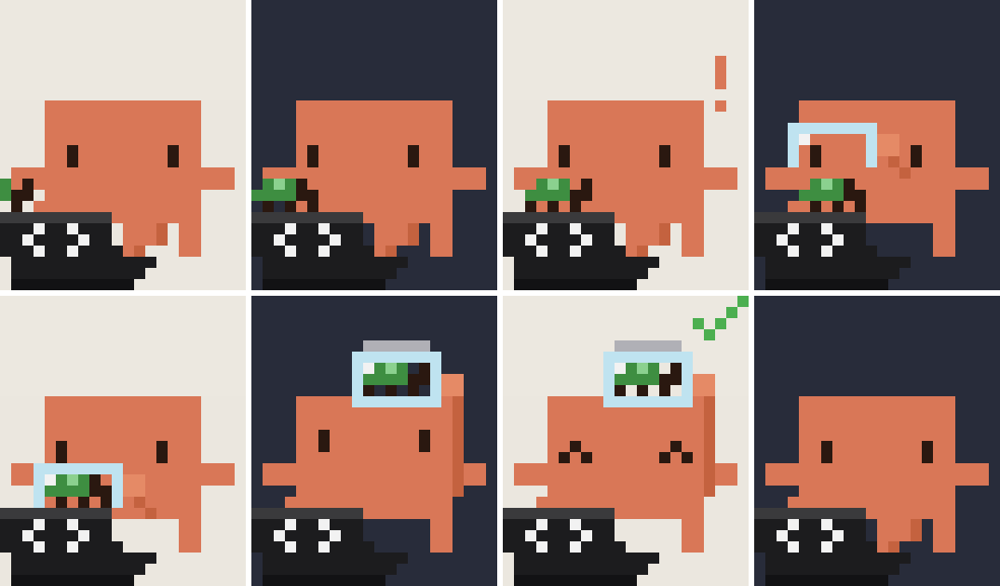
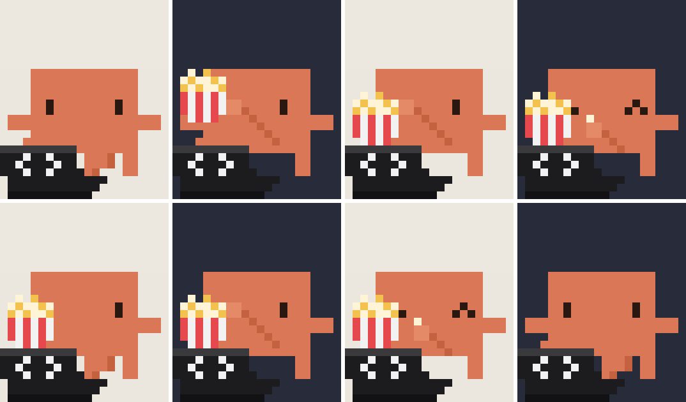
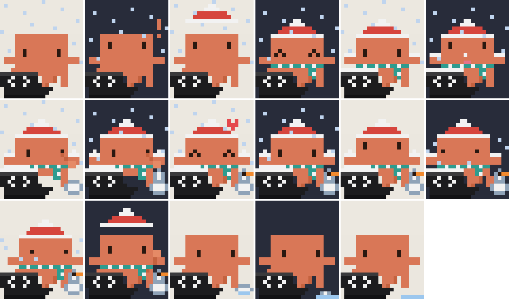
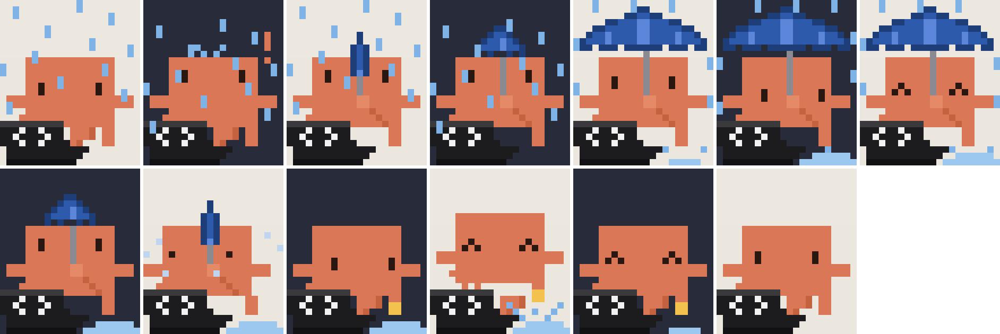
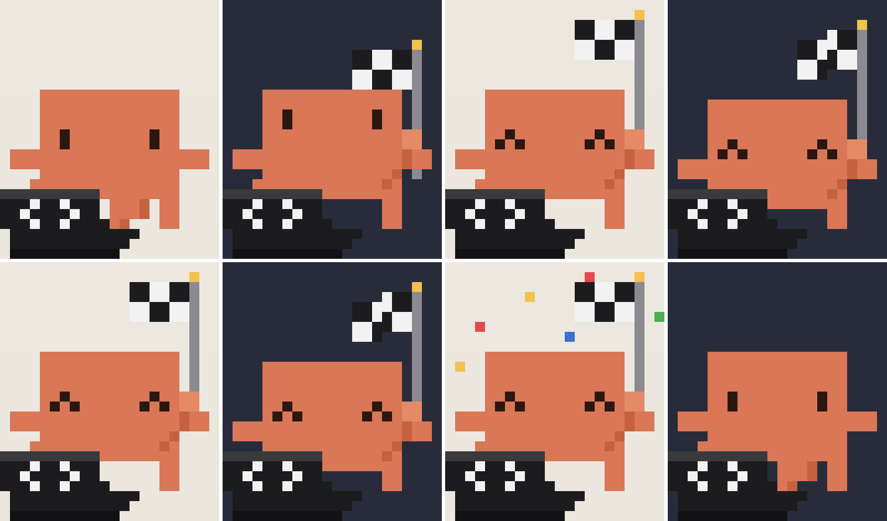

# Claude desktop pet

A little pixel Claude who lives in the corner of your Windows screen, types on his laptop and reacts to what Claude Code is doing.



He always stays on top, in the bottom-right corner of the screen you choose. Now and then he takes a break: coffee, sunglasses, a daydream, a bug hunt, music, a nap. He eats a croissant in the morning and a sandwich at lunch, then sweeps up the crumbs. The weather outside changes his scenes: snow, rain, fog, wind, heat, cold.

With Claude Code he:

- types faster while it works, and eats popcorn when a task runs long;
- waves a checkered flag when a turn is done;
- waves a "!" when Claude Code needs your answer.

One PowerShell 5.1 + WPF script. Nothing to install on Windows 10 or 11.

## Gallery

| | | |
|---|---|---|
|  |  |  |
|  |  |  |

Every pose has its storyboard in `storyboards/`.

## Install

```powershell
$dir = "$env:USERPROFILE\ClaudePet"
New-Item -ItemType Directory -Force $dir | Out-Null
Copy-Item .\ClaudePet.ps1, .\Start-ClaudePet.vbs, .\hooks\stop-hook.ps1, .\ClaudePet.ico $dir -Force
# start with Windows
Copy-Item .\Startup-ClaudePet.vbs "$env:APPDATA\Microsoft\Windows\Start Menu\Programs\Startup\Claude Pet.vbs"
# start now
Start-Process wscript.exe "`"$dir\Start-ClaudePet.vbs`""
```

Right-click him for the menu: pick the screen, make him do something, or say "Bye, Claude": he closes his laptop, waves and walks off the screen. The `Claude Pet` button brings him back: he walks in from the edge and says hi. Double-click starts a random pose. You can drag him around.

## Connect him to Claude Code

Add these hooks to `~/.claude/settings.json`. They only write the current time into small files that the pet checks once a second.

```json
{
  "hooks": {
    "UserPromptSubmit": [
      { "hooks": [ { "type": "command", "command": "cmd.exe", "args": ["/c", "echo %date% %time%> %USERPROFILE%\\ClaudePet\\busy.txt"] } ] }
    ],
    "PostToolUse": [
      { "matcher": "*", "hooks": [ { "type": "command", "command": "cmd.exe", "args": ["/c", "echo %date% %time%> %USERPROFILE%\\ClaudePet\\busy.txt"] } ] }
    ],
    "Notification": [
      { "matcher": "permission_prompt|elicitation_dialog|elicitation_url_dialog|agent_needs_input",
        "hooks": [ { "type": "command", "command": "cmd.exe", "args": ["/c", "echo %date% %time%> %USERPROFILE%\\ClaudePet\\wait.txt"] } ] }
    ],
    "Stop": [
      { "hooks": [ { "type": "command", "command": "powershell.exe",
          "args": ["-NoProfile", "-ExecutionPolicy", "Bypass", "-File", "%USERPROFILE%\\ClaudePet\\stop-hook.ps1"] } ] }
    ]
  }
}
```

The Stop hook reads the turn's transcript. It raises the flag when a turn ends (not when a background agent's report ends one) and the "!" only when that turn ended with a question for you.

## Settings

Optional: `%USERPROFILE%\ClaudePet\settings.json`.

```json
{
  "place": "Lyon",
  "latitude": 45.764,
  "longitude": 4.836,
  "weatherModel": "best_match",
  "newsLock": "%USERPROFILE%\\jobs\\scraper\\.lock"
}
```

- `place`, `latitude`, `longitude`: where the weather comes from. It's fetched every 15 minutes from [Open-Meteo](https://open-meteo.com/) (free, no key). Without the file he uses Lyon.
- `weatherModel`: an Open-Meteo model name. `best_match` picks one for you; `meteofrance_seamless` is the most precise for France.
- `newsLock`: a file that exists while some job of yours runs, for example a scraper that creates it at its start and deletes it at its end. He reads the newspaper the whole time. Leave it out for no newspaper.

## Files

- `ClaudePet.ps1`: the pet.
- `Start-ClaudePet.vbs`: starts him without a console window and brings him back if he crashes.
- `Startup-ClaudePet.vbs`: goes in the Windows Startup folder; waits for the launcher, then starts it.
- `hooks/stop-hook.ps1`: the Claude Code Stop hook.
- `frames/` and `tools/Make-Storyboard.ps1`: render any pose as a storyboard picture from the real script.
- `%USERPROFILE%\ClaudePet\pet.log`: starts, stops, weather changes and errors. Look here if he goes missing.
